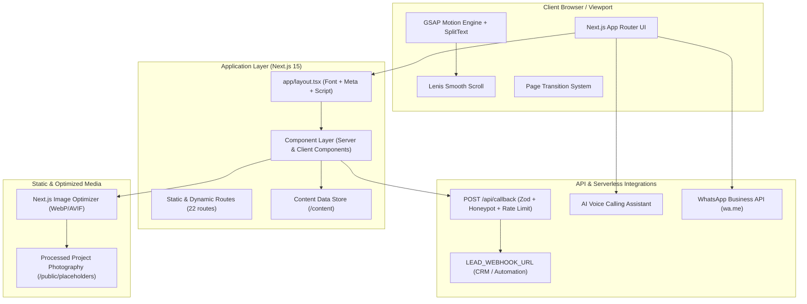
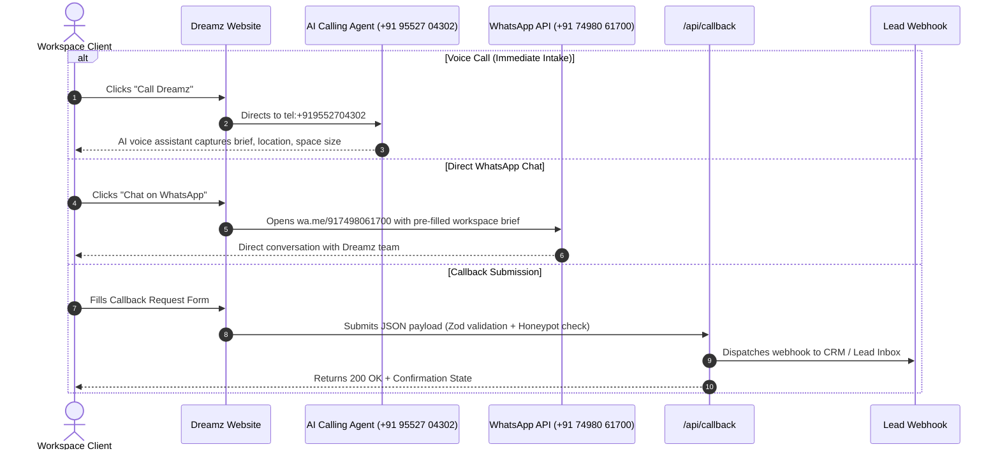
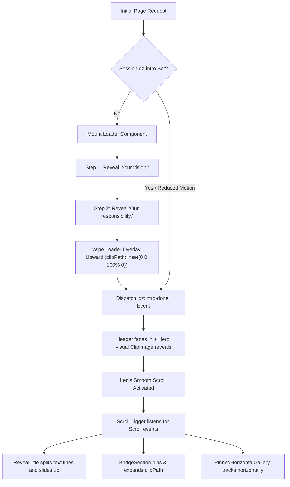

# Dreamz Marketing Website — System Architecture & Technical Report

**Document Version:** 1.0.0  
**Generated Date:** November 2026  
**Status:** Production Ready  
**Project:** Dreamz Marketing Website & Conversion Engine  
**Brand Identity:** *Your Vision, Our Responsibility*  

---

## 1. Executive Summary

This report documents the end-to-end software and design system architecture of the **Dreamz** marketing website. Dreamz is an accountable partner for commercial, modular, and turnkey workspace solutions across India (200+ delivered projects).

The platform is designed around three architectural pillars:
1. **Architectural & Editorial Identity:** Refined, deliberate, unhurried motion (Telha Clarke-inspired GSAP motion system, custom typography, full-bleed blueprint wordmarks, and balanced whitespace).
2. **High-Conversion Frictionless Onboarding:** Multi-channel lead intake with dedicated AI voice coordinator integration, direct WhatsApp click-to-chat triggers, and a Zod-validated callback request engine.
3. **Strict Content Separation & Decoupled Architecture:** 100% of copy and project data is strictly isolated in typed data models (`/content`), preventing hardcoded claims and ensuring adherence to brand rules (e.g. non-manufacturing operating model, 1-year direct warranty).

---

## 2. High-Level System Architecture Diagram



---

## 3. Technology Stack & Core Dependencies

| Category | Technology | Specification / Role |
|---|---|---|
| **Framework** | Next.js 15.5+ (App Router) | React Server Components (RSC), static site generation (SSG) with ISR capability |
| **Language** | TypeScript 5+ | Strict type-safety across content contracts and component props |
| **Styling** | Tailwind CSS 3.4+ | Utility-first CSS configured with custom brand design tokens |
| **Animation** | GSAP 3.14+ (`gsap`, `ScrollTrigger`, `SplitText`) | Line-by-line title reveals, scrubbed bridge clipping, pinned horizontal scrubbers |
| **Smooth Scroll** | `@studio-freight/lenis` | Inertial smooth scrolling synced directly to GSAP ticker |
| **Form Validation** | Zod 3.23+ | Strict schema validation with phone formatting and honeypot protection |
| **Typography** | `next/font/google` & Web Fonts | `Archivo` (Headings), `Inter` (Body), `Unbounded 900` (Footer Wordmark), `Space Mono` |
| **SEO & Meta** | Next.js Metadata API + JSON-LD | Structured Schema (`Organization`, `FAQPage`, `BreadcrumbList`), OpenGraph, Sitemap |

---

## 4. Directory & Codebase Structure

```text
├── app/
│   ├── layout.tsx                  # Global root shell (Fonts, Lenis, PageTransition, JSON-LD)
│   ├── globals.css                 # CSS custom properties, Lenis overrides, blueprint grid
│   ├── page.tsx                    # Home page (Hero, StatBar, Statement, Solutions, Case Studies, Process)
│   ├── about/page.tsx              # About page (Philosophy, Non-manufacturing statement, Principles)
│   ├── solutions/
│   │   ├── page.tsx                # Solutions hub
│   │   └── [slug]/page.tsx         # Dynamic solution lines (Commercial, Modular, Turnkey)
│   ├── projects/
│   │   ├── page.tsx                # Filterable project gallery
│   │   └── [slug]/page.tsx         # Case study detail templates with before/after sliders
│   ├── process/page.tsx            # 5-step detailed workspace delivery process
│   ├── contact/page.tsx            # Multi-channel contact hub with CallbackForm
│   ├── faqs/page.tsx               # Interactive FAQ accordion with JSON-LD schema
│   ├── privacy/page.tsx            # Privacy policy
│   ├── terms/page.tsx              # Terms of service
│   ├── sitemap.ts                  # Dynamic XML sitemap generator
│   ├── robots.ts                   # Search crawler directives
│   └── api/
│       └── callback/route.ts       # Secure callback endpoint (Rate-limiting, Zod, Webhook dispatcher)
├── components/
│   ├── BeforeAfterSlider.tsx       # Interactive dual-image comparison canvas
│   ├── BridgeSection.tsx           # Telha Clarke-inspired clip-path & translateX transition section
│   ├── Button.tsx                  # Wipe-hover buttons and primary action triggers
│   ├── CallbackForm.tsx            # Client callback form with phone masking and honeypot
│   ├── CallButton.tsx              # Direct telephone link with desktop intake modal
│   ├── ClipImage.tsx               # GSAP scroll-revealed image frame with reduced-motion fallback
│   ├── Footer.tsx                  # Giant architectural wordmark, blueprint grid, links, disclaimers
│   ├── Header.tsx                  # Scroll-reactive sticky header with backdrop blur
│   ├── Loader.tsx                  # 2-step entrance loader ("Your vision." -> "Our responsibility.")
│   ├── PageTransition.tsx          # Smooth route transition curtain
│   ├── PinnedHorizontalGallery.tsx # Pinned horizontal desktop project showcase
│   ├── PinnedProcess.tsx           # Step-by-step pinned interactive process timeline
│   ├── RevealTitle.tsx             # GSAP SplitText line-reveal component
│   ├── SmoothScroll.tsx            # Lenis smooth-scroll lifecycle provider
│   ├── SolutionCard.tsx            # Solution offering cards
│   ├── ProjectCard.tsx             # Work showcase cards with verified metadata
│   ├── StatBar.tsx                 # Animated milestone counters (200+ projects, Pan-India)
│   ├── StatementScroll.tsx         # Narrative text scroll scrubber
│   ├── TalkToUs.tsx                # Floating multi-channel drawer (Call, WhatsApp, Callback)
│   └── WhatsAppButton.tsx          # Permanent high-visibility click-to-chat button
├── content/                        # Decoupled Content Layer (Single Source of Truth)
│   ├── brand.ts                    # Name, positioning, promise, warranty rules, principles
│   ├── home.ts                     # Hero copy, stat metrics, CTA definitions
│   ├── solutions.ts                # Commercial, Modular, Turnkey service specifications
│   ├── projects.ts                 # 4 detailed case studies with challenges, metrics & galleries
│   ├── process.ts                  # 5-step delivery methodology
│   ├── contact.ts                  # Verified phone, WhatsApp, office coordinates, intake notices
│   ├── faqs.ts                     # 12 client FAQs
│   └── about.ts                    # Detailed company narrative & team commitments
├── docs/                           # Brand & Engineering Governance
│   ├── brand/                      # 8 authoritative brand documents (01 to 08)
│   ├── ai-agent-brief.md           # AI calling agent intake protocol & script guidelines
│   └── deployment.md               # Vercel & Render deployment guides
├── lib/
│   ├── analytics.ts                # Zero-dependency custom analytics dispatcher
│   ├── gsap.ts                     # Registered GSAP + ScrollTrigger + SplitText hooks
│   ├── intro.ts                    # Session-persisted intro state tracker
│   ├── motion.ts                   # Curated animation durations and bezier easings
│   ├── seo.ts                      # Canonical metadata and JSON-LD schema generators
│   └── validation.ts               # Zod contact request schema
└── public/
    └── placeholders/               # Real color-graded, shadow-lifted project photography
```

---

## 5. Key System Workflows

### 5.1 Multi-Channel Conversion Architecture

The conversion funnel provides three immediate communication paths:



### 5.2 Motion & Animation Lifecycle (Telha Clarke Style)



---

## 6. Design System & Tokens

The visual identity is grounded in an architectural palette with tactile contrast:

```css
:root {
  --paper: #F5F3EF;     /* Main canvas background */
  --stone: #E6E2DB;     /* Alternate sections & card backdrops */
  --charcoal: #1C1C1E;  /* Primary typography & high-contrast dark sections */
  --silver: #A8ABAF;    /* Secondary technical text, hairlines, and borders */
  --orange: #E8620C;    /* Accent: CTAs, active status indicators, key highlights */
}
```

### Typography Hierarchy:
- **Display & Headings:** `Archivo` (Latin, `display: swap`, optical kerning, `-0.025em` to `-0.035em` tracking).
- **Body & Prose:** `Inter` (16–18px, 1.6 line height for effortless readability).
- **Architectural Wordmark:** `Unbounded 900` (Geometric square-sans with uppercase expanded letterforms).
- **Technical & Coordinates:** `Space Mono` (Grid metadata, timestamps, specifications).

---

## 7. Security, Performance & Accessibility (a11y)

### 7.1 Security & Fraud Prevention
- **Honeypot Trap:** Hidden decoy input in [`CallbackForm.tsx`](file:///e:/DREAMZ%20INTERIORS/THE%20WEBSITE/Dreamz%20Codebase/components/CallbackForm.tsx) silently absorbs automated spam submissions without execution.
- **In-Memory Rate Limiting:** [`app/api/callback/route.ts`](file:///e:/DREAMZ%20INTERIORS/THE%20WEBSITE/Dreamz%20Codebase/app/api/callback/route.ts) enforces a strict IP window (maximum 5 requests per 10 minutes).
- **Payload Sanitization:** Form input fields are strictly parsed via Zod to strip script tags and unexpected schemas.

### 7.2 Accessibility & Usability (WCAG 2.1 AA)
- **Skip Links:** Dedicated keyboard bypass (`SkipLink.tsx`) allowing screen readers and keyboard users to skip header navigation directly to `#main-content`.
- **Contrast Ratios:** Charcoal on paper (`13.8:1`) and paper on charcoal (`13.8:1`) exceed WCAG AAA standards. Orange is reserved for large headings, accents, and high-contrast buttons.
- **Reduced Motion Support:** All GSAP timelines and Lenis animations check `(prefers-reduced-motion: reduce)`. When enabled, animations are bypassed instantly (`duration: 0.01ms`), ensuring comfortable reading for motion-sensitive users.

### 7.3 Performance Optimization
- **Next.js Image Pipeline:** Project photography is served through Next.js Image Optimization using AVIF and WebP formats with responsive `sizes` attributes, eliminating Cumulative Layout Shift (CLS).
- **Static Generation:** All 22 marketing, solutions, case study, and legal pages are pre-rendered into static HTML (`npm run build`), resulting in sub-100ms Time to First Byte (TTFB).

---

## 8. Deployment & Environment Configuration

### Required Environment Variables:
```ini
NEXT_PUBLIC_SITE_URL=https://dreamzworkspaces.com
NEXT_PUBLIC_PHONE_NUMBER="+91 95527 04302"
NEXT_PUBLIC_WHATSAPP_NUMBER="+91 74980 61700"
LEAD_WEBHOOK_URL=https://crm.dreamzworkspaces.com/webhook/leads
NOTIFY_EMAIL_TO=leads@dreamzworkspaces.com
NEXT_PUBLIC_ANALYTICS_ID=
```

### Production Build Verification:
- All 22 static pages compile with `0` type errors and `0` lint warnings:
  - `○ (Static)`: Home, About, Process, Contact, FAQs, Privacy, Terms, Robots, Sitemap.
  - `● (SSG)`: `/solutions/[slug]` (3 items) & `/projects/[slug]` (4 items).
  - `ƒ (Dynamic)`: `/api/callback` lead ingestion route.

